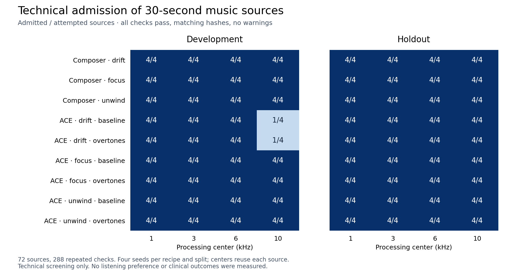

# Generation experiment — 2026-10-21

**72 of 72 sources generated successfully; 282 of 288 processing cases met the
full admission rule.** All six rejections were ACE-Step drift sources at a
10 kHz center. Adding the overtone description did not improve the observed
admission count. These are technical measurements, with no listener or clinical
outcomes.



## Design

The [fixed configuration](examples/generation-matrix.json) compares three
composer styles and six ACE-Step recipes: baseline and overtone descriptions
for drift, focus and unwind. Each source lasts 30 seconds. Development seeds
are 42–45 and holdout seeds are 142–145. Every source is generated once and
processed at 1, 3, 6 and 10 kHz. Each cell therefore has four sources; frequency
centers are repeated measurements, not additional independent sources.

The [saved plan](../artifacts/validation/generation-matrix-20261021/plan.json)
was written before execution. Processing uses a one-octave notch, −23 LUFS
target and −1 dBTP ceiling. Admission requires successful commands, matching
WAV hashes, passing checks and no warnings. The locally declared split is not
external preregistration. No recipes or thresholds changed during the run.

## Results and implications

At 1, 3 and 6 kHz, every source passed. The only variation occurred at 10 kHz:

| Recipe | Development | Holdout |
|---|---:|---:|
| Composer: each of drift, focus, unwind | 4/4 each | 4/4 each |
| ACE-Step drift baseline | 1/4 | 4/4 |
| ACE-Step drift with overtones | 1/4 | 4/4 |
| ACE-Step focus: each prompt variant | 4/4 each | 4/4 each |
| ACE-Step unwind: each prompt variant | 4/4 each | 4/4 each |

All 288 cases passed the numerical filter and output checks. The six rejected
cases triggered the source-coverage warning: both adjacent half-octave bands
contained less than −50 dB of total source power. This project threshold is an
engineering screening rule, not a validated clinical threshold. Checking only
`all_pass` would have admitted all six.

For drift development sources at 10 kHz, baseline admitted seed 42; the overtone
variant admitted seed 43. Both rejected seeds 44 and 45. Extra prompt wording
changed individual outputs without improving the count. The four held-out
seeds all passed for both recipes. This sample does not establish a general
failure rate, prompt superiority, or equivalence.

Using disjoint seed blocks for first-admitted selection gives the following
result for either drift prompt at 10 kHz:

| Budget | Development successful blocks | Holdout successful blocks |
|---|---:|---:|
| 1 source | 1/4 | 4/4 |
| 2 sources | 1/2 | 2/2 |
| 4 sources | 1/1 | 1/1 |

The overtone block recovered after seed 42 was rejected; baseline already
passed on its first attempt. Each four-source result contains only one block,
not evidence of a 100% future success rate. Budgets reuse the same seeds and
have different numbers of blocks; the holdout provides no observed advantage
for extra attempts.

Total elapsed time was 262.38 seconds. Median command-to-source time was
0.638 seconds for the composer and 2.112 seconds for ACE-Step. These include
CLI/HTTP polling and file handling, exclude model startup, and are not pure
inference benchmarks. The run used the pinned ACE-Step turbo model, disabled
LM, a 32 GiB PyTorch allocation limit and an RTX PRO 6000 Blackwell Server
Edition. Fixed recipe order and concurrent local verification may affect timing.

## Listening and product work

A technical review package was prepared from ACE-Step drift baseline,
development seed 42: notch at 6 kHz, passthrough, and sham at 1 kHz. All three
conditions passed; their loudness spread was **0.05049 LU**, below the 0.2 LU
packaging limit. Six playback orders balance positions and transitions.
The local `artifacts/audio/ace-paired-review-20261021/listening/` directory
contains neutral filenames; its sibling `private/` reveals the mapping.
No person has evaluated these clips, and balanced order does not establish
perceptual blinding.

The desktop [feedback path](feedback.md) now collects preference ratings and
optional discomfort responses. Its offline importer preserves listener
identity, deduplicates event IDs and excludes unanswered discomfort responses
from recommendation data. This makes future preference experiments executable;
it does not supply human evidence for this run.

Keep the existing warning gate and explicit retry behavior. Do not replace the
default prompt based on this result. A next experiment should use new seeds,
longer excerpts and a frozen listening protocol to compare music quality and
comfort among technically admitted sources. Any further prompt tuning needs
new held-out sources, because the present holdout has now been examined.

## Evidence

The [record](../artifacts/validation/generation-matrix-20261021/record.json)
contains source hashes, runtime revisions, timing and artifact hashes.
[Admission counts](../artifacts/validation/generation-matrix-20261021/admission.csv),
[budget results](../artifacts/validation/generation-matrix-20261021/budgets.csv)
and [individual measurements](../artifacts/validation/generation-matrix-20261021/cases.csv)
retain the full planned denominators. Source WAVs, command logs, manifests
and reports remain under `artifacts/audio/generation-matrix-20261021/`.
Verified processed WAVs were removed after their reports and hashes were saved.
No participant records or private condition mapping were committed.

Use the [benchmark instructions](benchmark.md) to run a new experiment.
The figure can be recreated from the saved CSV with Python and Matplotlib:

```bash
python artifacts/validation/generation-matrix-20261021/plot.py
```
